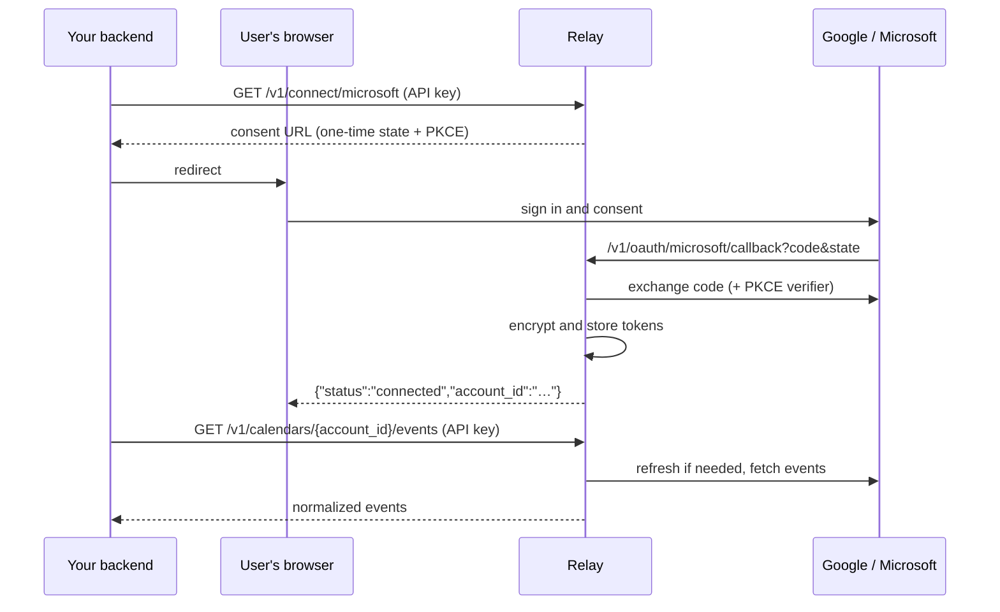

# Relay

[](https://github.com/sebasBetancourt/Relay/actions/workflows/ci.yml)
[](https://github.com/sebasBetancourt/Relay/releases)
[](LICENSE)

**One API for Google Calendar and Outlook.** Your users connect their Google or Microsoft account once; Relay handles OAuth, keeps their tokens encrypted and fresh, and reads and writes their events in a single shape, whatever the provider.

Integrating Google and Microsoft calendars separately means two OAuth flows, two token lifecycles (Microsoft rotates refresh tokens on every refresh), two event formats and two sets of edge cases. Relay is that work, done once and tested.

```bash
curl -H "Authorization: Bearer $RELAY_KEY" \
  "http://localhost:8080/v1/calendars/$ACCOUNT_ID/events?max_results=2"
```
```json
{
  "events": [
    {"id": "…", "title": "Standup", "start": "2026-10-20T14:00:00Z", "end": "2026-10-20T14:30:00Z",
     "timezone": "America/Bogota", "all_day": false, "provider": "microsoft"},
    {"id": "…", "title": "Planning", "start": "2026-10-21T15:00:00Z", "end": "2026-10-21T16:00:00Z",
     "timezone": "America/Bogota", "all_day": false, "provider": "microsoft"}
  ],
  "next_page_token": "…"
}
```

## Features

| | Google | Microsoft (Outlook / M365) |
| --- | :---: | :---: |
| Connect with OAuth 2.0 + PKCE | ✅ | ✅ (work, school and personal accounts) |
| Read events from the primary calendar (recurrences expanded) | ✅ | ✅ (Windows time zones → IANA) |
| Create, edit and delete events (recurrences, time zones, idempotent) | ✅ `RRULE` | ✅ `patternedRecurrence` |
| Silent token refresh | ✅ | ✅ (rotating refresh tokens, safe across replicas) |
| Detect revoked access (`409`, reconnect) | ✅ | ✅ (including MFA / Conditional Access) |
| Disconnect an account | ✅ (token revoked at Google) | ✅ |
| Push when a calendar changes (optional) | ✅ watch channel | ✅ Graph subscription |
| Incremental sync (stored copy; the read API still calls the provider) | ✅ `syncToken` | ✅ `deltaLink` |

- **Secure by default.**
  - OAuth tokens are encrypted with AES-256-GCM, each value bound to its tenant, account and column.
  - API keys are stored as hashes and shown once.
  - The OAuth `state` is one-time and expires.
  - Secrets are never logged.
- **Multi-tenant.** Each customer gets its own API keys and only ever sees its own accounts.
- **Built to run.**
  - Small distroless image (`linux/amd64`, `linux/arm64`).
  - Fails fast on bad config.
  - Health and readiness probes, structured JSON logs with request ids.
  - Background cleanup of expired OAuth states.
  - Per-tenant rate limits that survive a Redis outage.
- **Tested end to end.** Every flow runs against stateful fake Google and Microsoft servers in CI, with no real accounts needed.

## How it works



## Quickstart

Requirements: Docker. You also need OAuth credentials for at least one provider: follow [Google setup](docs/google-cloud-setup.md) or [Microsoft setup](docs/microsoft-setup.md), about 10 minutes each.

1. Clone and configure:

   ```bash
   git clone https://github.com/sebasBetancourt/Relay.git && cd Relay
   cp .env.example .env
   ```

   In `.env`, set `ENCRYPTION_KEY` (`openssl rand -base64 32`), `RELAY_ENV=test` and the variables of the providers you use.

2. Start Postgres, run the migrations and start the API:

   ```bash
   docker compose up -d --build
   curl localhost:8080/readyz    # ready
   ```

3. Create a tenant. Its API key is printed once:

   ```bash
   docker compose exec -T api relayctl tenant create --name "Acme" > acme.key
   ```

4. Connect an account: open the printed URL and accept.

   ```bash
   curl -s -H "Authorization: Bearer $(cat acme.key)" -H "Accept: application/json" \
     localhost:8080/v1/connect/google | jq -r .authorization_url
   ```

5. Read the events, using the `account_id` from step 4:

   ```bash
   curl -s -H "Authorization: Bearer $(cat acme.key)" localhost:8080/v1/accounts | jq
   curl -s -H "Authorization: Bearer $(cat acme.key)" "localhost:8080/v1/calendars/<account_id>/events" | jq
   ```

Or run [`scripts/demo.sh`](scripts/demo.sh), which walks through the same steps for you.

Prefer prebuilt artifacts? Each [release](https://github.com/sebasBetancourt/Relay/releases) ships binaries for Linux, macOS and Windows (migrations included) and an image at `ghcr.io/sebasbetancourt/relay`.

## API

All `/v1` routes except the OAuth callback and the webhook endpoints take `Authorization: Bearer <api key>`. Webhooks are off unless `WEBHOOK_BASE_URL` is set.

| Method | Path | What it does |
| --- | --- | --- |
| `GET` | `/v1/connect/{provider}` | Start connecting a `google` or `microsoft` account (302, or 200 JSON). `?features=calendar.write` adds write access |
| `GET` | `/v1/oauth/{provider}/callback` | OAuth callback (public; called by the browser) |
| `GET` | `/v1/accounts` | List the tenant's connected accounts |
| `DELETE` | `/v1/accounts/{id}` | Disconnect an account |
| `GET` | `/v1/calendars/{id}/events` | List events, normalized across providers |
| `POST` | `/v1/calendars/{id}/events` | Create an event |
| `PATCH`, `DELETE` | `/v1/calendars/{id}/events/{event_id}` | Update or delete an event or series |
| `GET` | `/v1/me` | The tenant behind the API key |
| `POST` | `/v1/webhooks/google` | Google push notification (public; no API key) |
| `POST` | `/v1/webhooks/microsoft` | Graph notification, or the `validationToken` handshake |
| `POST` | `/v1/webhooks/microsoft/lifecycle` | Graph subscription lifecycle (renew, resubscribe, missed) |
| `GET` | `/healthz`, `/readyz` | Liveness and readiness probes |

- **[API guide](docs/api.md)**: every endpoint with `curl` examples, paging and the full error table.
- **[OpenAPI 3.1 spec](api/openapi.yaml)**: the formal contract, ready for Swagger UI, Postman or client generators.

## Rate limits

Each tenant has a request budget (600 per minute with a burst of 100 by default, adjustable per tenant) enforced in Redis, so it holds across replicas and one noisy customer cannot starve the others. Over the limit, clients get `429` with `Retry-After` and standard `RateLimit` headers. Details in the [API guide](docs/api.md#rate-limits).

## Configuration

Set through environment variables (see [`.env.example`](.env.example)). The API checks everything at startup and lists every problem at once.

| Variable | Required | Notes |
| --- | --- | --- |
| `DATABASE_URL` | yes | Postgres 16 |
| `ENCRYPTION_KEY` | yes | 32 random bytes, base64. Losing it makes stored tokens unreadable. |
| `RELAY_ENV` | yes | `live` or `test`: which API keys (`rly_live_` / `rly_test_`) this deployment accepts |
| `GOOGLE_CLIENT_ID`, `GOOGLE_CLIENT_SECRET`, `GOOGLE_REDIRECT_URL` | one provider | All or none |
| `MICROSOFT_CLIENT_ID`, `MICROSOFT_CLIENT_SECRET`, `MICROSOFT_REDIRECT_URL` | one provider | All or none |
| `MICROSOFT_TENANT_ID` | no | `common` (default), `organizations`, `consumers` or a directory |
| `MICROSOFT_EXPIRATION_DATE` | no | Client secret expiry (`YYYY-MM-DD`): warns 30 days before, refuses to start after |
| `PORT`, `LOG_LEVEL` | no | `8080`, `info` |
| `WEBHOOK_BASE_URL` | no | Public `https` origin for calendar push. Empty keeps polling |
| `REDIS_URL` | no | Shares rate limit budgets across replicas. Empty keeps one budget per replica. If Redis fails, the API keeps serving with a local limit |
| `RATE_LIMIT_PER_MINUTE`, `RATE_LIMIT_BURST` | no | Per tenant: `600`, `100` |
| `RATE_LIMIT_IP_PER_MINUTE`, `RATE_LIMIT_IP_BURST` | no | Per IP, on the OAuth callback and requests without a valid key: `1200`, `200` |
| `NATS_URL` | no | JetStream. Required when `WEBHOOK_BASE_URL` is set. When set, delta sync consumes `relay.sync.account`. Empty leaves async work off, and startup says so. Failed jobs land in `RELAY_DLQ`; `relayctl dlq list` and `relayctl dlq replay <seq>` inspect and requeue them |

## Documentation

- [API guide](docs/api.md) and [OpenAPI spec](api/openapi.yaml)
- Provider setup: [Google](docs/google-cloud-setup.md), [Microsoft Entra ID](docs/microsoft-setup.md)
- [Design](docs/design.md) and [architecture decisions](docs/adr/)
- [Development](docs/development.md): build, tests and project layout
- [Secret scanning](docs/secret-scanning.md): how leaked API keys are detected

## Contributing

Issues and pull requests are welcome; start with [CONTRIBUTING.md](CONTRIBUTING.md). Report vulnerabilities privately as described in [SECURITY.md](SECURITY.md). This project follows a [code of conduct](CODE_OF_CONDUCT.md).

## License

[MIT](LICENSE)
