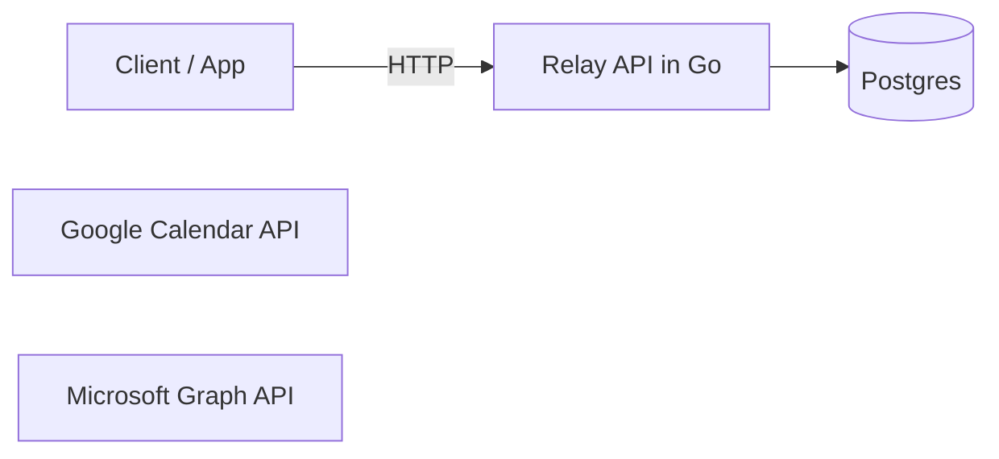
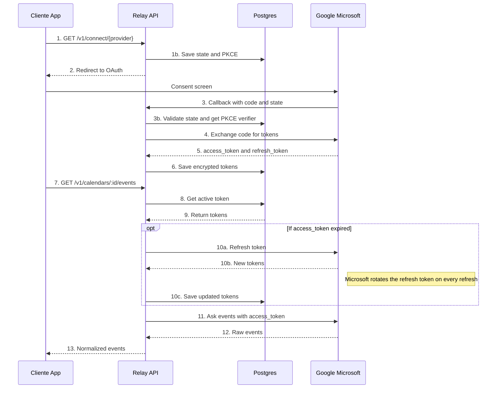

# Relay v0.1
## Microsoft - Google - Calendars API

### Problem
- Many enterprises and startups, integrate microsoft and Google, all yours tools, whats they a used for the same, a developer, would have integrate one by one.
- Emerge problems with the rotation of tokens, clients, principally for a API to robust with it is Microsoft, and development from zero whats i will take weeks, and depends of the requerid tools or apps of this services.
-  I offer a solution, the unificated of the two APIs. For the version 1.0, we will take the apps of calendar of google and outlook, in a one API aplicated the due security and a integration secure and scalable.

### Scopes

#### Scope v0.1
- Management minim of users, tenats with API key
- OAuth 2.0 authorization code flow + PKCE with Google and Microsoft
- Library of Microsft Integrate MSAL
- Google, directlly OAuth 2.0 with library of Golang golang.org/x/oauth2
- Minimun Scopes incrementals, client secret and .envs
- Vault of tokens, cifrate and correct refresh - Microsoft save the refresh token every time
- List events with the same format for the two suppliers - GET api/v1/calendar/{id}/events
- Enviroments Docker and Postgresql
- Documentation, Readme with diagram and how starts the proyect.
- Cifrate of tokens in the Database AES - GCM
- Validate State in the callback, avoid attacks CSRF
- Disconnect a account and revoque their tokens
- Manage tokens revoques
- Test and CI github actions

#### Scope v02.0
- Workers for the first sincronization and the reconection
- Webhooks of calendars - Google watchs channels and subscriptions graphs 
- Delta Sync with backup, if to lost a webhook
- Redis, Throlling, and rate limiting for tenat

#### Scope v03.0
- Landing Page with documentation OpenAPI

### Diagram

### Diagram OAuth and events

### Request flow

#### A. Connect account

> Status: steps 1–5 are implemented for Google: `internal/oauth` (Start/Finish), HTTP in `internal/httpapi`, token encryption in `internal/vault`.

1. Client calls `GET /v1/connect/{provider}` with its API key.

   At this point **no OAuth tokens exist yet**. The API only generates three random values:

   | Value | Role |
   | --- | --- |
   | `state` | Random CSRF guard. On callback, proves the response matches a connect you started. **Not** related to token expiry. |
   | `code_verifier` (PKCE) | Random secret kept by Relay. |
   | `code_challenge` | Hash of the verifier; sent to the provider in the authorize URL. |

   Persist `state` + `code_verifier` in `oauth_states` with a short TTL (e.g. 10 minutes).

   | Failure | HTTP |
   | --- | --- |
   | Unsupported `{provider}` | **400** Bad Request |
   | Missing or invalid API key | **401** Unauthorized |

2. API redirects the browser to the consent screen.

   v0.1 is read-only events — ask for the minimum:

   | Provider | Scopes |
   | --- | --- |
   | Google | `openid` (id_token → `sub` as `provider_account_id`), `calendar.readonly` |
   | Microsoft | `Calendars.Read`, `offline_access` (required for refresh token), `User.Read` |

   **Implemented:** connect start (`GET /v1/connect/{provider}`) and Google callback (`GET /v1/oauth/{provider}/callback`) — steps 3–5: consume state, exchange code + PKCE, encrypt with AAD `("oauth_tokens", tenantID, provider, providerAccountID, column)`, upsert `connected_accounts` + `oauth_tokens`.

   Do **not** request write scopes “just in case”. Mail and other tools are out of scope for v0.1.

3. Provider calls the callback with `code` + `state`.

   Validate first (in order):

   1. `state` exists in `oauth_states`
   2. It has not expired
   3. It has not been used before
   4. Then **delete** it (one-time use)

   If invalid/expired/reused → **400** Bad Request. Do **not** retry automatically (could be an attack). The user must start connect again.

4. API exchanges the code for tokens.

   Send to the provider: `code`, `code_verifier`, `redirect_uri`, `client_id`, `client_secret`.

   Do **not** send `state` in this step.

5. API encrypts and saves the tokens.

   - **Protocol** to obtain tokens: OAuth 2.0 + PKCE (not a storage algorithm).
   - **Encryption at rest**: AES-256-GCM (see Scope).
   - Tables:
     - `connected_accounts` — which provider account belongs to which tenant
     - `oauth_tokens` — encrypted `access_token` + `refresh_token`, plus `expires_at`

#### B. Read events

**Implemented:** `GET /v1/calendars/{id}/events` (steps 6–9). `{id}` is `connected_accounts.id` (the `account_id` from the callback); events come from that account’s **primary** calendar. Default window: `now` → `now+30d`. Refresh uses a **60s skew** and **singleflight per account** so concurrent requests share one token refresh. AAD for decrypt matches connect: `("oauth_tokens", tenantID, provider, providerAccountID, column)`.

6. Client calls `GET /v1/calendars/{id}/events`.

   Tenant comes from the API key in `Authorization`. With that tenant, check that calendar/account `{id}` belongs to it.

   If the account is not theirs → **404** Not Found (avoid leaking that the id exists for another tenant). Prefer 404 over 403 for cross-tenant lookups.

7. API loads and decrypts the token.

   | Case | Behavior |
   | --- | --- |
   | `access_token` expired (or within 60s of expiry) | Refresh silently with the provider. Save new tokens (Microsoft rotates refresh every time). Continue the request — **do not** send the user through connect again. |
   | Refresh fails (`invalid_grant` / revoked) | Mark account as `revoked`, delete tokens, return **409** Conflict with a clear body (e.g. `account_revoked`) so the client reconnects. Do **not** use 401 here — that means bad API key. The account **can** be reconnected. |

8. API asks the provider for events.

   Call the provider with `Authorization: Bearer <access_token>`. On **401**, force one refresh and retry once.

9. API normalizes and returns them.

   Common event shape (fields shared by Google and Outlook):

   | Field | Notes |
   | --- | --- |
   | `id` | Provider event id |
   | `title` | Summary / subject (empty string if missing — never invented) |
   | `start` | RFC3339 with offset when timed; `YYYY-MM-DD` when `all_day` |
   | `end` | Same formats; exclusive for all-day (Google/Outlook) |
   | `timezone` | IANA tz when timed (event tz, else calendar tz) |
   | `all_day` | Boolean |
   | `location` | Optional |
   | `organizer` | Optional object `{"email","name"}` |
   | `provider` | `google` or `microsoft` |

### Data model

#### tenants

| column | type | notes |
| --- | --- | --- |
| `id` | `uuid` | PK. Prefer uuid over serial: random, hard to guess, better for multi-tenant URLs/APIs. |
| `name` | `text` | Display name. DB enforces `CHECK (char_length(name) BETWEEN 1 AND 200)` so the rule holds even for raw SQL inserts. |
| `created_at` | `timestamptz` | |

#### api_keys

One tenant can have many keys (rotation, multiple environments). Hash is SHA-256 hex of the plaintext (`rly_live_` / `rly_test_` + entropy + CRC32); never store the plaintext. Lookup by hash is O(1) via UNIQUE; the API also keeps a short in-memory cache (30s) of hash → tenant so hot traffic does not hit Postgres every request. Revoking clears the entry on the instance that revoked; other instances may accept the key until their entry expires.

| column | type | notes |
| --- | --- | --- |
| `id` | `uuid` | PK. |
| `tenant_id` | `uuid` | FK → `tenants(id)` **ON DELETE CASCADE**. |
| `key_hash` | `text` | SHA-256 hex, **UNIQUE**. |
| `key_prefix` | `text` | Public snippet for logs/UI (e.g. `rly_test_xxxxxxxx…`). |
| `created_at` | `timestamptz` | |
| `last_used_at` | `timestamptz` | Not written yet. Planned: updated on successful auth, best-effort and throttled so auth never writes on every request. |
| `revoked_at` | `timestamptz` | NULL = active. Set to revoke without deleting the tenant. |

#### connected_accounts

| column | type | notes |
| --- | --- | --- |
| `id` | `uuid` | PK. |
| `tenant_id` | `uuid` | FK → `tenants(id)` **ON DELETE CASCADE** (if the tenant goes, its accounts go). |
| `provider` | `enum` (`google`, `microsoft`) | Enum so the DB rejects bad values — not free text. |
| `provider_account_id` | `text` | Stable id (or email) of the account at Google/MS. |
| `status` | `enum` (`active`, `revoked`, `disconnected`, `error`) | Keep it small for v0.1. Use `error` when refresh succeeded at the provider but saving the new tokens failed. Expiry lives on tokens/`expires_at`, not as a status. |
| `created_at` | `timestamptz` | |

**UNIQUE:** `UNIQUE (provider, provider_account_id)` — same Google/MS account cannot be linked twice as two rows.

If two different tenants **may** connect the same provider account, use `UNIQUE (tenant_id, provider, provider_account_id)` instead.

> Do not put UNIQUE on `(id, provider_account_id)`: `id` is already unique alone, so that constraint never blocks duplicates.

A tenant has **N** connected accounts (Google and Microsoft are separate rows). Each account has **one** token row (see below).

#### oauth_tokens

| column | type | notes |
| --- | --- | --- |
| `account_id` | `uuid` | **PK and FK** → `connected_accounts(id)` **ON DELETE CASCADE**. **1:1** with the account — not 1:N. Google and Microsoft are different `connected_accounts` rows, each with its own tokens. |
| `access_token_enc` | `bytea` | Ciphertext from AES-256-GCM. `bytea` is the **column type** (raw bytes), not the encryption algorithm. |
| `refresh_token_enc` | `bytea` | Same: AES-256-GCM ciphertext stored as bytes. |
| `access_nonce` | `bytea` | ~12 random bytes for AES-GCM. Required to decrypt; must be unique per encryption under the same key. One nonce per ciphertext. |
| `refresh_nonce` | `bytea` | Same for the refresh token ciphertext. |
| `expires_at` | `timestamptz` | When the **access** token expires (drives silent refresh). |
| `scopes` | `text[]` | Scopes the user **actually** granted (may be fewer than requested), e.g. `{calendar.readonly}`. |
| `updated_at` | `timestamptz` | Updated on every refresh (Microsoft rotates refresh every time). |

#### oauth_states

Short-lived rows from connect step 1 (~10 min). Used only until callback.

| column | type | notes |
| --- | --- | --- |
| `state` | `text` | PK. Random CSRF value sent to the provider and checked on callback. |
| `tenant_id` | `uuid` | FK → `tenants(id)` **ON DELETE CASCADE**. Who started connect — so the callback knows which tenant owns the new account. |
| `provider` | `enum` (`google`, `microsoft`) | Which provider to exchange the `code` with. |
| `code_verifier` | `text` | PKCE secret sent in the token exchange. Lives ~10 minutes; plaintext is acceptable, encrypting is nicer. |
| `expires_at` | `timestamptz` | Validity window (~10 min). |
| `used_at` | `timestamptz` | NULL until consumed. Set on successful callback so the same `state` cannot be reused (replay). |

**Cleanup (implemented):** a janitor inside the API process runs on startup and every 10 minutes. It deletes expired rows in batches (`LIMIT 1000`) with `FOR UPDATE SKIP LOCKED`, so multiple replicas can purge concurrently without blocking each other or an in-flight `Consume`. `used_at` is unused (design says delete, not mark) and may be dropped later.

#### FK / delete summary

| Child | Parent | ON DELETE |
| --- | --- | --- |
| `api_keys.tenant_id` | `tenants.id` | **CASCADE** |
| `connected_accounts.tenant_id` | `tenants.id` | **CASCADE** |
| `oauth_tokens.account_id` | `connected_accounts.id` | **CASCADE** |
| `oauth_states.tenant_id` | `tenants.id` | **CASCADE** |

### Risks

| Risk | Impact | Mitigation |
| --- | --- | --- |
| Token leak (DB stolen) | Attacker can call Google/MS as the user | Encrypt at rest (AES-256-GCM), key outside the DB; mass revoke + anomaly monitoring |
| Encryption key lost or leaked | Cannot decrypt tokens; full data exposure if leaked | v0.1: key in env/secret manager, never in DB or repo; KMS + rotation later |
| Microsoft refresh token rotation (save fails) | Old refresh invalid; API thinks it still has access | Persist new refresh in a transaction before using the new access token; on save failure mark account `error` and stop |
| User revokes access in Google/MS | Calls fail with `invalid_grant` | Mark account `revoked`, delete tokens, return **409** (see Request flow §7) |
| Provider rate limits (429) | Client errors / degraded UX | Exponential backoff honoring `Retry-After`; cache and queues in v0.2 |
| Google doesn't return refresh_token | Cannot refresh; reconnect required often | Request `access_type=offline` and `prompt=consent` |
| CSRF / replay on callback | Attacker links their provider account to a victim tenant | One-time `state` with ~10 min TTL + PKCE |
