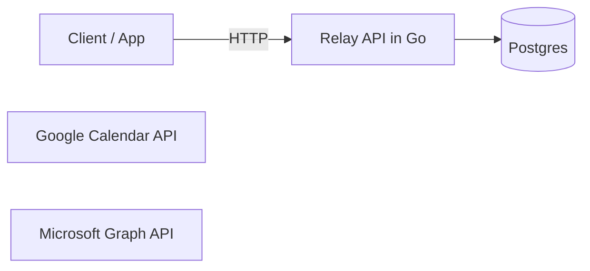
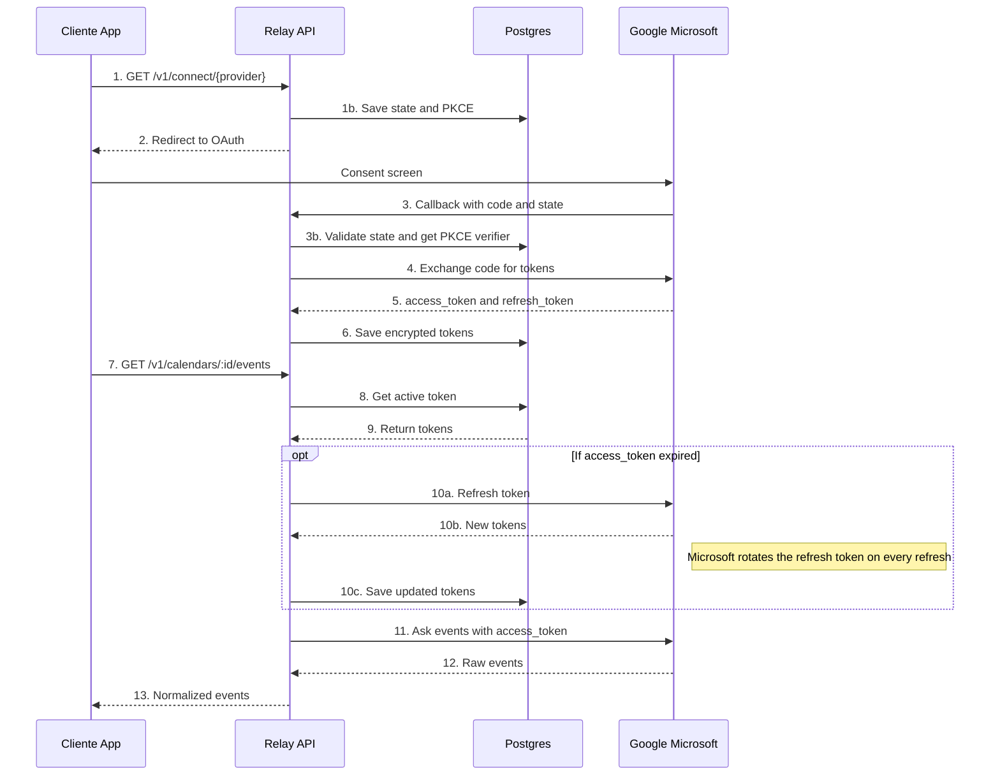

# Relay v0.1
## Microsoft - Google - Calendars API

### Problem
- Many enterprises and startups, integrate microsoft and Google, all yours tools, whats they a used for the same, a developer, would have integrate one by one.
- Emerge problems with the rotation of tokens, clients, principally for a API to robust with it is Microsoft, and development from zero whats i will take weeks, and depends of the requerid tools or apps of this services.
-  I offer a solution, the unificated of the two APIs. For the version 1.0, we will take the apps of calendar of google and outlook, in a one API aplicated the due security and a integration secure and scalable.

### Scopes

#### Scope v0.1
- Management minim of users, tenats with API key
- OAuth 2.0 authorization code flow + PKCE with Google and Microsoft
- Library of Microsft Integrate MSAL
- Google, directlly OAuth 2.0 with library of Golang golang.org/x/oauth2
- Minimun Scopes incrementals, client secret and .envs
- Vault of tokens, cifrate and correct refresh - Microsoft save the refresh token every time
- List events with the same format for the two suppliers - GET api/v1/calendar/{id}/events
- Enviroments Docker and Postgresql
- Documentation, Readme with diagram and how starts the proyect.
- Cifrate of tokens in the Database AES - GCM
- Validate State in the callback, avoid attacks CSRF
- Disconnect a account and revoque their tokens
- Manage tokens revoques
- Test and CI github actions

#### Scope v02.0
- Workers for the first sincronization and the reconection
- Webhooks of calendars - Google watchs channels and subscriptions graphs 
- Delta Sync with backup, if to lost a webhook
- Redis, Throlling, and rate limiting for tenat

#### Scope v03.0
- Landing Page with documentation OpenAPI

### Diagram

### Diagram OAuth and events

### Request flow

#### A. Connect account

1. Client calls `GET /v1/connect/{provider}` with its API key.

   At this point **no OAuth tokens exist yet**. The API only generates three random values:

   | Value | Role |
   | --- | --- |
   | `state` | Random CSRF guard. On callback, proves the response matches a connect you started. **Not** related to token expiry. |
   | `code_verifier` (PKCE) | Random secret kept by Relay. |
   | `code_challenge` | Hash of the verifier; sent to the provider in the authorize URL. |

   Persist `state` + `code_verifier` in `oauth_states` with a short TTL (e.g. 10 minutes).

   | Failure | HTTP |
   | --- | --- |
   | Unsupported `{provider}` | **400** Bad Request |
   | Missing or invalid API key | **401** Unauthorized |

2. API redirects the browser to the consent screen.

   v0.1 is read-only events — ask for the minimum:

   | Provider | Scopes |
   | --- | --- |
   | Google | `calendar.readonly` |
   | Microsoft | `Calendars.Read`, `offline_access` (required for refresh token), `User.Read` |

   Do **not** request write scopes “just in case”. Mail and other tools are out of scope for v0.1.

3. Provider calls the callback with `code` + `state`.

   Validate first (in order):

   1. `state` exists in `oauth_states`
   2. It has not expired
   3. It has not been used before
   4. Then **delete** it (one-time use)

   If invalid/expired/reused → **400** Bad Request. Do **not** retry automatically (could be an attack). The user must start connect again.

4. API exchanges the code for tokens.

   Send to the provider: `code`, `code_verifier`, `redirect_uri`, `client_id`, `client_secret`.

   Do **not** send `state` in this step.

5. API encrypts and saves the tokens.

   - **Protocol** to obtain tokens: OAuth 2.0 + PKCE (not a storage algorithm).
   - **Encryption at rest**: AES-256-GCM (see Scope).
   - Tables:
     - `connected_accounts` — which provider account belongs to which tenant
     - `oauth_tokens` — encrypted `access_token` + `refresh_token`, plus `expires_at`

#### B. Read events

6. Client calls `GET /v1/calendars/{id}/events`.

   Tenant comes from the API key in `Authorization`. With that tenant, check that calendar/account `{id}` belongs to it.

   If the account is not theirs → **404** Not Found (avoid leaking that the id exists for another tenant). Prefer 404 over 403 for cross-tenant lookups.

7. API loads and decrypts the token.

   | Case | Behavior |
   | --- | --- |
   | `access_token` expired | Refresh silently with the provider. Save new tokens (Microsoft rotates refresh every time). Continue the request — **do not** send the user through connect again. |
   | Refresh fails (`invalid_grant` / revoked) | Mark account as `revoked`, delete tokens, return **409** Conflict with a clear body (e.g. `account_revoked`) so the client reconnects. Do **not** use 401 here — that means bad API key. The account **can** be reconnected. |

8. API asks the provider for events.

   Call the provider with `Authorization: Bearer <access_token>`.

9. API normalizes and returns them.

   Common event shape (fields shared by Google and Outlook):

   | Field | Notes |
   | --- | --- |
   | `id` | Provider event id |
   | `title` | Summary / subject |
   | `start` | Start datetime |
   | `end` | End datetime |
   | `timezone` | IANA tz when timed |
   | `all_day` | Boolean |
   | `location` | Optional |
   | `organizer` | Optional (email / name) |
   | `provider` | `google` or `microsoft` |
