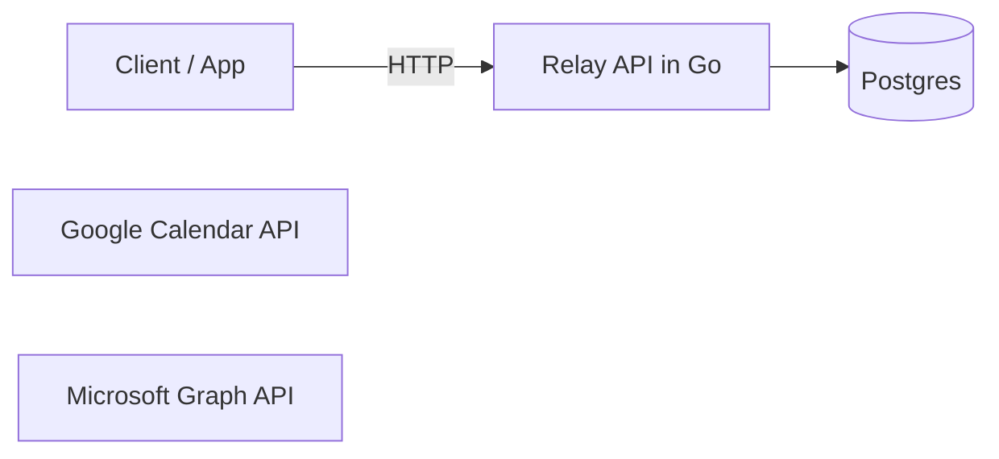
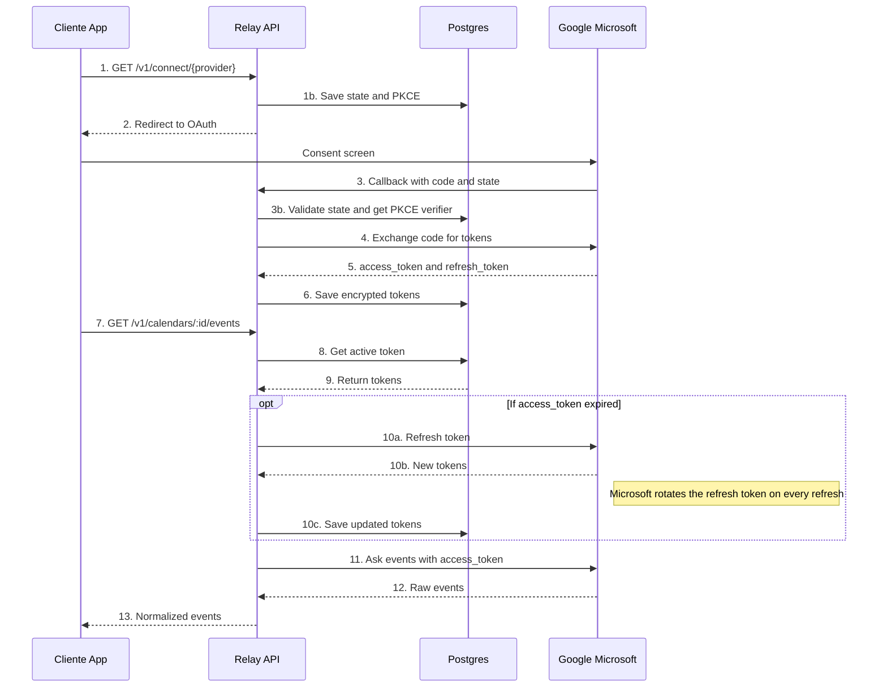

# Relay v0.1
## Microsoft - Google - Calendars API

### Problem
- Many enterprises and startups, integrate microsoft and Google, all yours tools, whats they a used for the same, a developer, would have integrate one by one.
- Emerge problems with the rotation of tokens, clients, principally for a API to robust with it is Microsoft, and development from zero whats i will take weeks, and depends of the requerid tools or apps of this services.
-  I offer a solution, the unificated of the two APIs. For the version 1.0, we will take the apps of calendar of google and outlook, in a one API aplicated the due security and a integration secure and scalable.

### Scopes

#### Scope v0.1
- Management minim of users, tenats with API key
- OAuth 2.0 authorization code flow + PKCE with Google and Microsoft
- Library of Microsft Integrate MSAL
- Google, directlly OAuth 2.0 with library of Golang golang.org/x/oauth2
- Minimun Scopes incrementals, client secret and .envs
- Vault of tokens, cifrate and correct refresh - Microsoft save the refresh token every time
- List events with the same format for the two suppliers - GET api/v1/calendar/{id}/events
- Enviroments Docker and Postgresql
- Documentation, Readme with diagram and how starts the proyect.
- Cifrate of tokens in the Database AES - GCM
- Validate State in the callback, avoid attacks CSRF
- Disconnect a account and revoque their tokens
- Manage tokens revoques
- Test and CI github actions

#### Scope v02.0
- Workers for the first sincronization and the reconection
- Webhooks of calendars - Google watchs channels and subscriptions graphs 
- Delta Sync with backup, if to lost a webhook
- Redis, Throlling, and rate limiting for tenat

#### Scope v03.0
- Landing Page with documentation OpenAPI

### Diagram

### Diagram OAuth and events

